# FT Engine User Manual

Version: 2.0.1 · Updated: 2026-10-15

[简体中文](../zh/manual.md) | [日本語](../ja/manual.md) | [Documents and examples](../README.md)

## 1. Getting started

FT Engine is a desktop electronic judging application for free practice and tournaments. It accepts BLE or USB counters and provides score overlays, YouTube scoring, event replay, reports and exports.

Install and open the packaged application. Node.js and Python are source development requirements; event staff do not need to install them separately. For real scoring, enable Bluetooth or connect the USB counters, check their power, and release connections held by other applications. Local scoring and reports work offline; YouTube playback requires an internet connection.

Use the left navigation. The old home history dialog and top settings panel have been replaced by dedicated pages.

| Page | Purpose |
| --- | --- |
| Dashboard | New matches, recent competitions, active work and health notices |
| Competitions | Continue setup, open reports or replay, delete a project |
| Replay | Filter events by project, group, contestant and referee |
| Settings | Language, theme, shortcut, OBS protection and local data |

The play, chart and clapperboard icons in a competition row open setup, reports and replay respectively. Hover for tooltips. The more menu contains project deletion; export anything you need before confirming it.

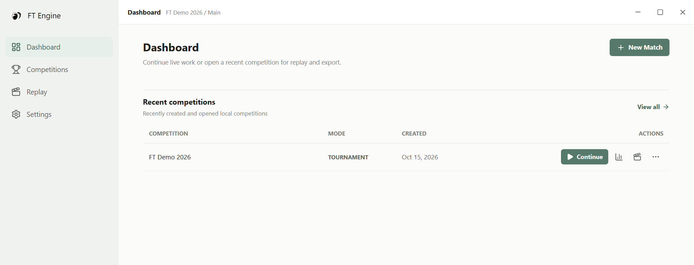

## 2. Language, theme and event controls

Open Settings in the left navigation.

1. Choose 简体中文, English or 日本語 in Language; the interface changes immediately.
2. Choose the light or dark theme.
3. Focus the reset shortcut field and press a combination such as `Ctrl+G`. Wait for the saved indicator. It is registered on the scoring page; choose another combination if your system already uses it.
4. Enable OBS protection when needed. It protects the main window while leaving the overlay available. Preview your actual OBS capture source before the event.

On the scoring page, Auto makes the shortcut perform Next; with Auto off, it performs Zero (reset). Auto is initially on. It does not advance on a timer or detect the end of a video. Check both device readiness and score persistence.

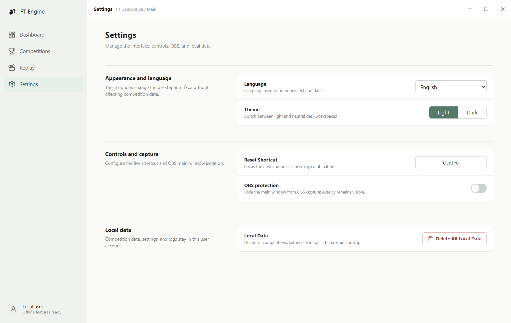

Delete All Local Data removes the local competition database, backups, the managed exports directory and logs, then restarts the application. Settings reside in the database and are removed too. This is irreversible; see section 13.

## 3. Projects, stages and contestants

Select New Match from Dashboard or Competitions, enter a project name and choose a mode.

**Free Mode:** Set 1-32 referees and select Next to go directly to device binding. The initial context is `Main / Free Mode / Player 1`, with one attempt. Completing a contestant can append Player 2 and subsequent contestants.

**Tournament Mode:** Select Next to open Stages & Groups. Set the stage name and 1-20 attempts, then configure each group's name, referee count and contestants. Enter one contestant per line. Import List accepts CSV, XLSX and XLS; when multiple columns are detected, select and confirm the name column. Review the imported list.

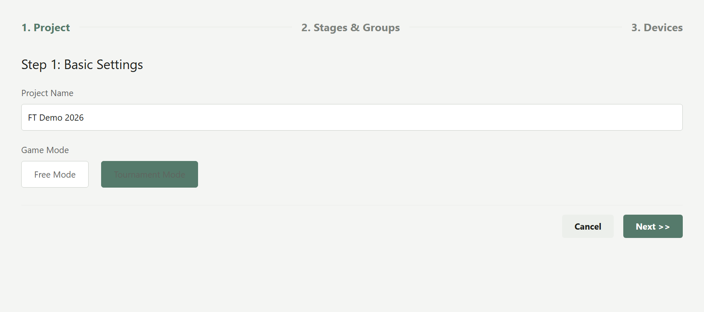

The buttons below the stage list add, move or delete stages. At least one stage must remain. Structure changes and draft deletion depend on the page's editing conditions. Save & Next persists the configuration and opens device binding.

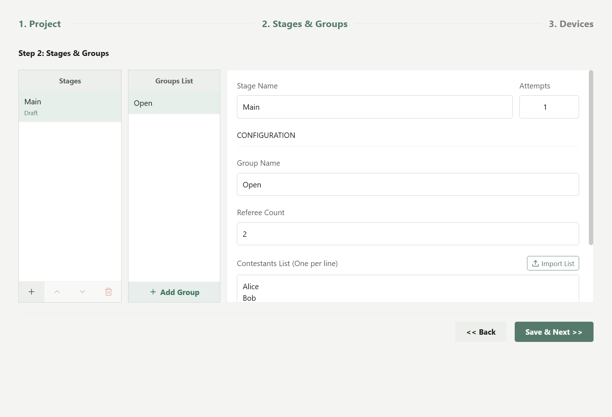

Stage states are Draft, Active and Completed. The current wizard permits structure editing only while all stages are drafts. After scoring starts, continue using the configured stages, groups and attempts. Complete Stage is available for an active stage after every contestant attempt is finished; completed stages are not offered for starting. To run another attempt, end scoring, continue the project and select that attempt. It does not advance automatically.

## 4. Scanning, binding and connecting counters

1. Check the stage, group and attempt on the device page.
2. Select Refresh. BLE requires Bluetooth; USB requires a recognized port. If none appear, check power, connections and competing applications.
3. Enter each referee's name, choose Single or Dual, and assign the required primary and secondary devices. Each device must have a unique assignment.
4. Select Start Match. The connection dialog shows each primary and secondary device's status.
5. When all selected devices connect, the application resets them and opens scoring. Check the contestant, connection indicators and zero scores before judging.

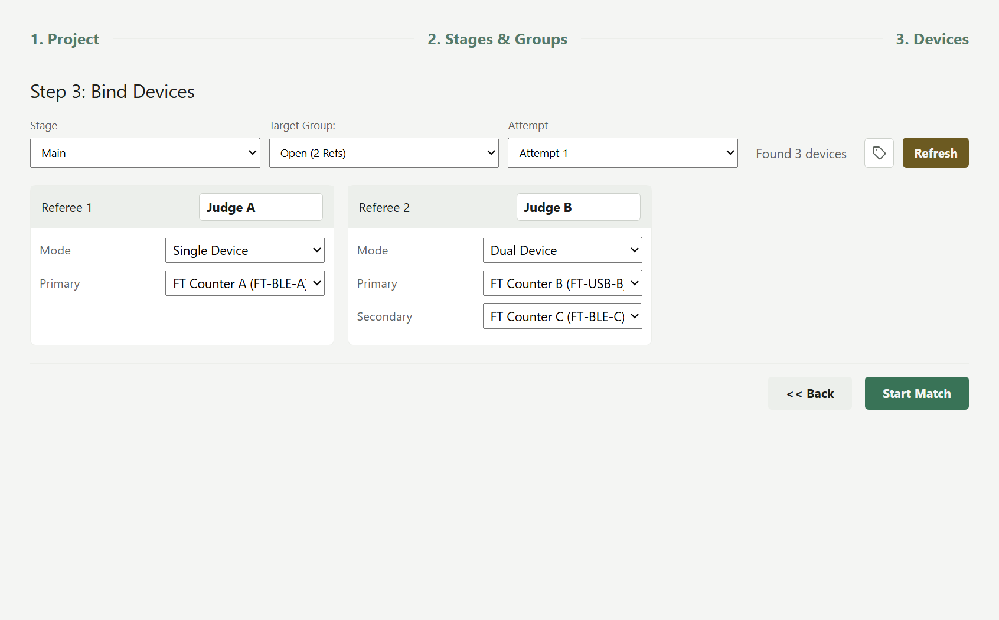

Single uses the primary device. Dual uses primary and secondary devices; the major penalty label describes their scoring behavior, not a third device. See section 5 for the formulas.

Device remarks are saved locally. After changing remarks, Permanent Device Rename is a separate action: select only the devices whose Bluetooth names you intend to write, then apply. Skipping this step retains the local remarks. Older firmware may not support permanent renaming.

After approximately eight seconds without all connections, or earlier if a device errors, cancel and investigate or use Enter Anyway. Enter Anyway bypasses waiting; it does not connect a failed device. If the device service fails, use Retry Device Service where offered, then verify every connection and actual button input.

## 5. Scoring after connection

Check the stage, attempt, group and contestant at the top of scoring. Test each counter against its referee, then reset before the actual performance.

| Status | Meaning and action |
| --- | --- |
| Devices ready and connected referee indicators | Check that each input reaches the intended referee |
| Reconnecting / connection error | Pause official scoring and restore connectivity |
| Saving / scores saved | Local write in progress / latest event persisted |
| Score save failure | Pause scoring; inspect storage space, permissions and logs |
| Video unaligned / aligned | Whether accurate video timing is available, independently of device readiness |

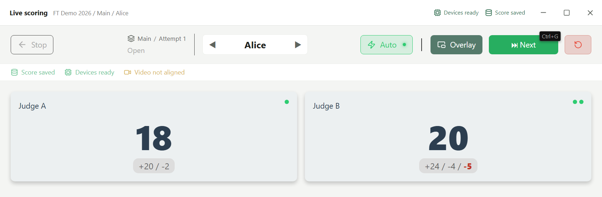

**Single:** Total = primary positive count − primary negative count. Plus and minus show those counts; major penalty is zero.

**Dual:** Plus = primary positive count; minus = secondary positive count; total = plus − minus. Major penalty = primary negative count + secondary negative count. It is recorded separately and does not reduce the live card total; reports can subtract it after scaling.

In the example, Judge A has positive 20 and negative 2, giving total 18. Judge B has primary 24/3 and secondary 4/2, giving plus 24, minus 4, total 20 and major penalty 5.

## 6. Next, manual selection and reset

**Finish and advance:** Select Next to complete the current contestant and find the next unscored one. After a successful switch, device counters and displayed scores reset. A check mark in the contestant selector indicates completion for this attempt. The arrows and dropdown also change the active contestant, with session persistence and device reset; they are not a read-only history browser.

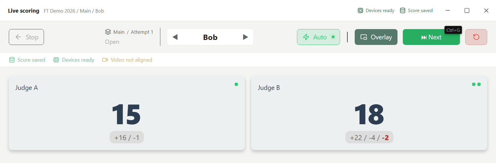

With Auto on, Next and the reset shortcut advance directly. With Auto off, Next can request confirmation and the shortcut resets. Don't Ask Again saves the corresponding confirmation preference.

**Reset only:** Select the circular arrow Zero control and confirm when prompted. It keeps the contestant and resets live counters. It does not delete prior events or invalidate the session; subsequent events use the new counts. Use session invalidation when appropriate instead of treating reset as erasure.

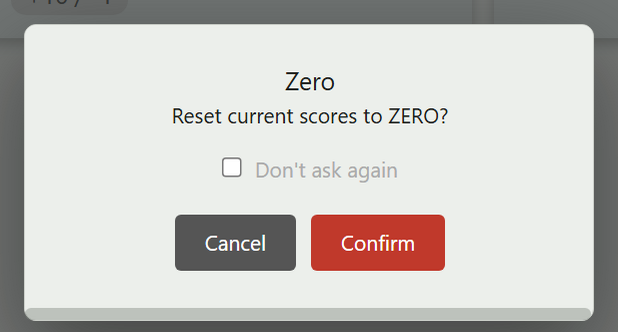

Free Mode appends contestants at the end of the list. After all tournament contestants are finished, choose Save & Exit Match or Continue from Start. Rejudging creates further records, not another configured attempt. For a formal second attempt, return to setup and select it. If switching fails, verify which contestant is still active before entering more scores.

## 7. Window overlays and OBS

1. Open the target application window first.
2. On scoring, select Overlay, then Window Overlay.
3. Choose a window or Full Screen and start the overlay.

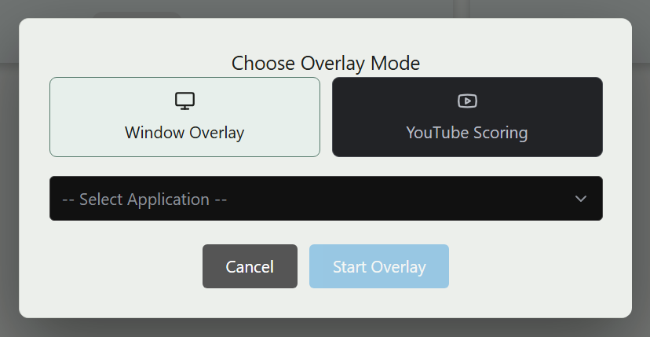

Move the pointer over the overlay dock area to reveal its controls: next contestant, reset, waveform visibility, settings and close. The dock's `R` reset runs immediately; check the contestant before using it.

Drag cards to move them and use corner handles to resize them. Click a score glyph and scroll to change font size. Settings offer Split, Total, Combined and Realtime display, opacity and background color. Realtime shows short bursts of increments rather than the final cumulative score.

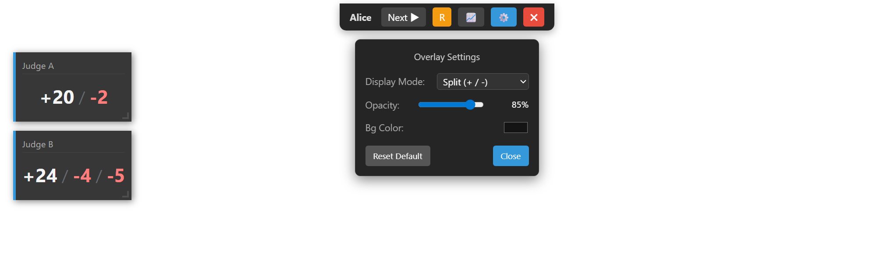

Closing the overlay returns to the main window while scoring continues. Save and end from the scoring page before closing the entire application. OBS results depend on the operating system and capture source; preview both main-window protection and score visibility before going live.

## 8. YouTube video scoring

1. Check the current contestant and select Overlay.
2. Choose YouTube Video Scoring and paste that contestant's valid YouTube URL.
3. Enter the player and wait for the video to load. Choose a score display mode and drag the score panel as needed.
4. Before pressing counters, confirm the video belongs to the contestant and check that video status becomes aligned.
5. Exit Player returns to referee cards. The player's link control changes the video. Recheck the binding after changing contestants.

Video bindings are saved per contestant; counters still supply scores. Pasting a URL alone does not provide valid video timing. Events recorded while the player is not ready, synchronization is stale, or video/contestant context does not match can still be saved, but cannot provide accurate replay seek points. Binding a video later does not reconstruct past event timing.

## 9. Saving, ending and invalidating

Select Stop at the upper left of scoring, then choose:

- **Save and End:** Complete the session, stop devices and return to Dashboard. If ending fails, address the error and retry; confirm the active scoring state has ended.
- **Invalidate Session:** Check the contestant, stage, group and attempt in the second confirmation. The session is marked invalidated; saved raw events remain.
- **Cancel:** Resume the current scoring page.

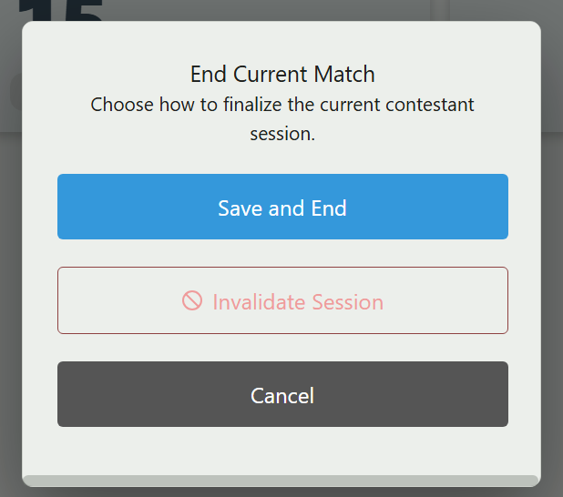

Invalidation differs from deleting a project. In 2.0.1, the completed-contestant query uses session status, but reports and some exports still read latest or all events without consistently excluding invalidated sessions. After invalidating, manually verify results before treating a report as an official result with invalid scores excluded. Review repeated scoring records too.

## 10. Raw and scaled reports

Open the project's chart icon from Dashboard or Competitions and choose a group on the left. Switch between Raw and Scaled views.

Raw shows each referee's total, counts and major penalty; its average uses the configured referee count. Scaled normalizes each referee against their highest positive total in the group. Advanced Settings changes the ratio (default 60) and the major penalty option.

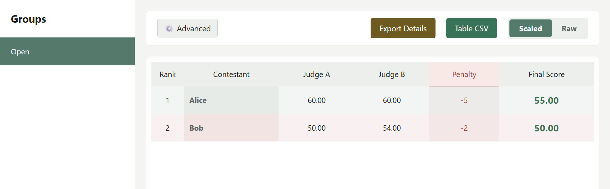

| Calculation | Rule |
| --- | --- |
| Referee scaled score | Raw total ÷ that referee's group maximum × ratio; zero if the maximum is not positive |
| Standard major penalty | Mode of the dual referees' major penalties; choose the largest value on a frequency tie |
| Final score | Average of all configured referee scaled scores, minus standard penalty when enabled |

Missing results count as zero when scaling. Raw averages also use all configured referees rather than silently omitting missing ones. Negative results are possible.

At ratio 60, Alice gets 60 and 60, minus 5 = 55. Bob gets 50 and 54, averaging 52, minus 2 = 50. The current report page has no stage or attempt filter and does not rank by best attempt. Verify repeated attempts, invalidated sessions and same-name groups across stages; use distinguishable group names across stages where possible.

## 11. Exporting CSV, SRT and ZIP

**Table CSV:** Choose the group and Raw or Scaled view, check ratio and penalty options, then select Table CSV and choose a location in the system save dialog. This exports the group's summary.

**Details ZIP:** Open Export Details, select contestants and formats, then Download ZIP and choose a destination. At least one contestant and one format are required.

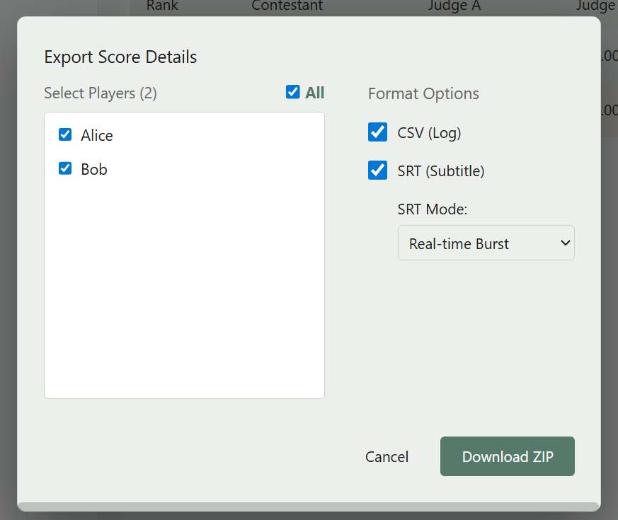

| Format | Contents |
| --- | --- |
| CSV log | Relative timestamps, positive/negative counts, total and major penalty events |
| SRT | Total, Split or Realtime score subtitles |
| ZIP | Detail files organized by group, contestant and referee |

Canceling the save dialog creates no file and is not an export failure. Details require score events. If export fails, check the selection, write permission and available storage.

SRT and log times are relative to each referee's first event system time, **not the YouTube media timeline**. Align them yourself in an editor. The [scaled summary](../examples/Open_scaled.csv) and [detail archive](../examples/FT_Demo_details.zip) provide example results.

## 12. Event and video replay

1. Open a competition's replay icon or Replay in the navigation.
2. Hover over the narrow left edge of the player, or focus it, to open the filter/event drawer.
3. Choose project, group and contestant; optionally filter by referee.
4. Events show system time, device role, changes, cumulative total and media synchronization status.
5. Click an aligned event with a media timestamp to seek to the video position. Unaligned events remain visible but cannot be used to seek.

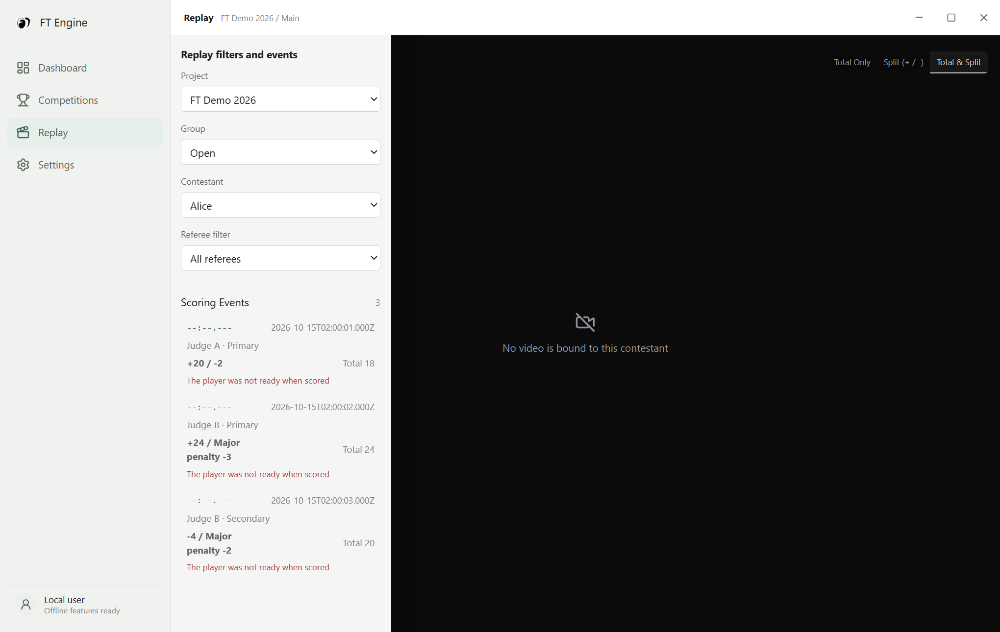

During video playback the score panel uses available synchronized events. Its display mode and position can be changed. Events can still be inspected without a video. If none appear, recheck the project, group, contestant and referee filter. Hover at the narrow left edge again if the drawer has closed.

## 13. Troubleshooting and local data

| Symptom | Action |
| --- | --- |
| No BLE devices | Enable Bluetooth; check power, range and other connections; refresh |
| USB unresponsive | Check cable, port, drivers and competing applications |
| No scores after Enter Anyway | Waiting was bypassed; verify real connections and assignments |
| Device service error | Retry the device service, then verify each connection and input |
| Save failure | Pause judging; inspect storage, permissions and logs; do not delete data to troubleshoot |
| Contestant switch failure | Check the error and active contestant before continuing |
| Replay cannot seek | The event needs aligned media timing; later binding does not backfill it |
| Export failure | Check events, selected scope, destination permission and space |

Current competitions and settings use SQLite (`ft-engine.db`) in Electron's user data directory, replacing the old `match_data` and `app_settings.json` storage. To preserve resumable projects, close the application and back up the entire user data directory. CSV and ZIP results cannot be imported through the current UI as resumable projects.

Delete Project removes the selected project. Delete All Local Data removes the database, its WAL/SHM files, backups, managed exports and logs, then restarts. Files saved separately elsewhere are managed separately. Both deletion operations are irreversible.

## 14. Complete workflow example

Use FT Demo 2026 to follow the complete workflow: connect counters, score contestants, switch, reset, save and review results.

| Contestant | Judge A single (+ / −) | Judge B primary (+ / −) | Judge B secondary (+ / −) | Raw A / B | Penalty B | Final at ratio 60 |
| --- | --- | --- | --- | --- | --- | --- |
| Alice | 20 / 2 | 24 / 3 | 4 / 2 | 18 / 20 | 5 | 55.00 |
| Bob | 16 / 1 | 22 / 0 | 4 / 2 | 15 / 18 | 2 | 50.00 |

1. Bind three counters for `FT Demo 2026 / Main / Open / Attempt 1`, start and confirm the scoring page opens.
2. Feed Alice's counts; verify totals 18, 20 and penalty 5.
3. Select Next; verify Bob is active and scores reset. Feed Bob's counts.
4. Confirm Zero; verify Bob remains selected and scores are zero. Feed Bob's counts again.
5. Select Stop → Save and End; verify scoring is inactive.
6. Check Alice 55.00 and Bob 50.00 in reports, open export options and inspect Alice's three replay events.
