# FT Engine ユーザーマニュアル

対象バージョン：2.0.1 · 更新日：2026-10-15

[简体中文](../zh/manual.md) | [English](../en/manual.md) | [資料とサンプルの一覧](../README.md)

## 1. はじめに

FT Engine は、練習と大会の電子審判採点に使用するデスクトップアプリです。BLE または USB カウンターによる採点、スコアのオーバーレイ、YouTube 動画採点、イベントのリプレイ、レポートとエクスポートに対応します。

配布版はインストール後、そのまま起動できます。Node.js と Python はソース開発用の要件であり、大会スタッフが別途インストールする必要はありません。実機を使う場合は Bluetooth を有効にするか USB を接続し、電源と他のアプリによる占有を確認してください。ローカル採点とレポートはオフラインで利用でき、YouTube 再生にはネット接続が必要です。

旧版のホーム画面の履歴ダイアログと上部設定パネルは、左側ナビゲーションの専用ページに置き換わりました。

| ページ | 用途 |
| --- | --- |
| ダッシュボード | 新規試合、最近の大会、作業の続行、異常の確認 |
| 大会 | 設定の続行、レポート、リプレイ、プロジェクト削除 |
| リプレイ | プロジェクト・グループ・選手・審判によるイベント絞り込み |
| 設定 | 言語、テーマ、ショートカット、OBS 保護、ローカルデータ |

大会一覧の再生・グラフ・カチンコのアイコンは、それぞれ設定の続行・レポート・リプレイを開きます。マウスを置くと説明が表示されます。その他の操作からプロジェクトを削除できます。必要な資料は削除前にエクスポートしてください。

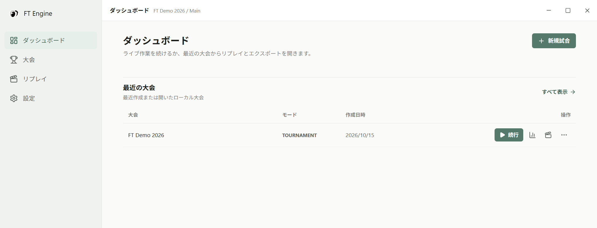

## 2. 言語・テーマ・現場設定

左側の「設定」を開きます。

1. 言語を简体中文・English・日本語から選択すると、表示が即時に切り替わります。
2. ライトまたはダークテーマを選択します。
3. リセット用ショートカット欄を選び、`Ctrl+G` などを押し、保存済み表示を確認します。採点ページで登録されるため、システムと競合する場合は別の組み合わせにしてください。
4. 必要に応じて OBS 保護を有効にします。メインウィンドウを保護し、オーバーレイは対象外です。本番前に実際の OBS キャプチャ方式で確認してください。

採点ページの「自動」が有効な場合、ショートカットは「次へ」を実行し、無効な場合は「ゼロ」を実行します。初期状態は有効です。時間経過や動画終了を検知して自動的に選手を進める機能ではありません。接続状態とスコアの保存状態を両方確認します。

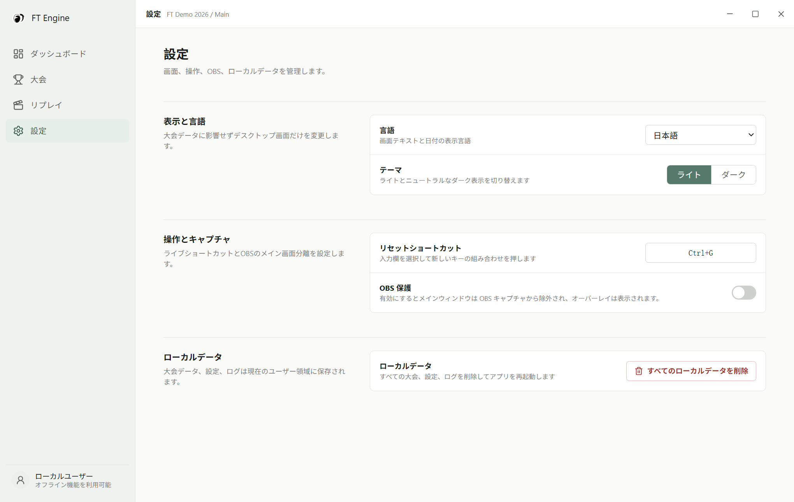

「すべてのローカルデータを削除」は大会データベース、バックアップ、アプリ管理のエクスポートとログを削除して再起動します。設定もデータベース内に保存されるため削除されます。元に戻せません。第 13 節を参照してください。

## 3. プロジェクト・ステージ・選手名簿

ダッシュボードまたは大会ページから新規試合を作成し、プロジェクト名とモードを指定します。

**フリーモード：** 審判数（1～32）を設定し「次へ」でデバイス割り当てへ進みます。初期構成は `Main / Free Mode / Player 1`、試行は 1 回です。完了後に Player 2 以降を追加できます。

**大会モード：** 「次へ」でステージとグループを設定します。ステージ名、試行回数（1～20）、各グループの名前・審判数・選手を入力します。選手は 1 行に 1 人です。名簿のインポートは CSV・XLSX・XLS に対応し、複数列を検出した場合は氏名列を選んで確定します。取り込み後に名簿を確認してください。

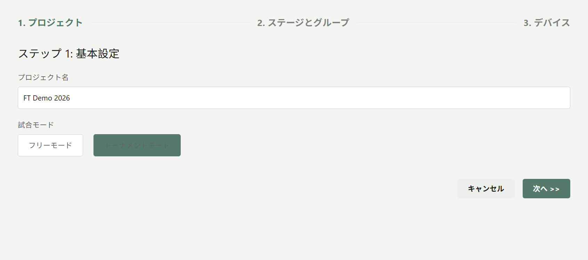

ステージ一覧の下のボタンで追加・並べ替え・削除を行います。少なくとも 1 ステージが必要です。構造変更や下書きの削除には画面の編集条件が適用されます。「保存して次へ」で構成を保存し、デバイス設定へ進みます。

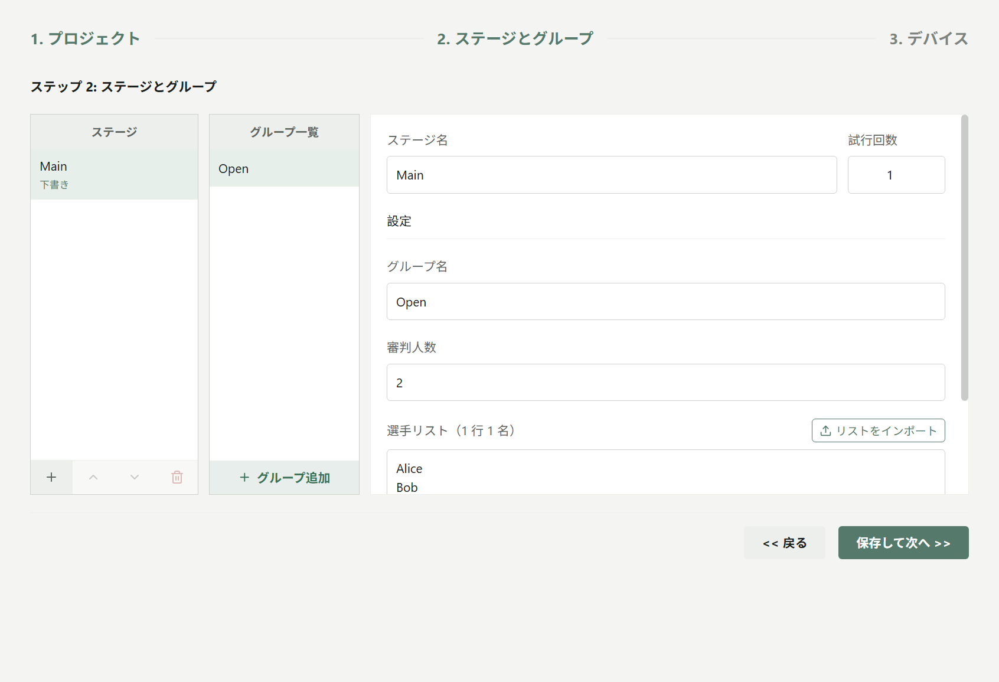

ステージは下書き・進行中・完了の状態を持ちます。現行ウィザードで構造を編集できるのは全ステージが下書きの間だけです。採点開始後は既存のステージ・グループ・試行を使用します。全選手の全試行が終了すると、進行中ステージを完了にできます。完了ステージは開始候補に表示されません。次の試行は自動開始せず、採点終了後に設定を続行して選び直します。

## 4. カウンターの検索・割り当て・接続

1. デバイス設定でステージ・グループ・試行を確認します。
2. デバイス一覧を更新します。BLE は Bluetooth、USB は認識されたポートが必要です。表示されない場合は電源・接続・他アプリの占有を確認します。
3. 各審判名を入力し、単機または双機を選択して主・副デバイスを割り当てます。同じデバイスを重複して使うことはできません。
4. 「試合開始」を押すと、ダイアログに主・副デバイスの接続状態が表示されます。
5. 選択した全デバイスの接続成功後、ゼロにリセットされ採点画面が開きます。選手・状態点・ゼロのスコアを確認します。

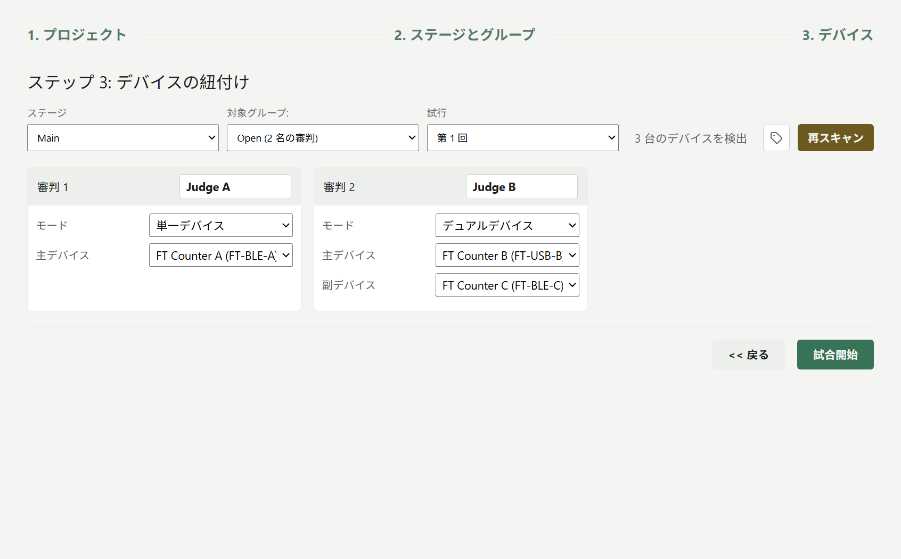

単機は主デバイス、双機は主・副デバイスを使用します。重大減点の表示は双機の採点上の意味を示し、3 台目のデバイスを意味しません。計算方法は第 5 節を参照してください。

デバイスのメモはローカルに保存されます。変更後の恒久的なデバイス名変更は別操作です。Bluetooth 名を書き換えたい項目だけを選択して実行してください。スキップしてもメモは保存されます。旧ファームウェアでは恒久変更が利用できない場合があります。

約 8 秒経過しても全接続が完了しない場合やエラー発生時は、キャンセルして調べるか「そのまま進む」を選択できます。この操作は待機を省くだけで、接続失敗を解消しません。サービス異常時は表示された再試行ボタンを使用し、復旧後に各接続と実際のボタン入力を確認してください。

## 5. 接続成功後の採点

画面上部のステージ・試行・グループ・選手を確認します。各カウンターの入力先が正しい審判であることをテストし、本番前にゼロに戻します。

| 状態 | 意味と対応 |
| --- | --- |
| デバイス準備完了・接続済みの状態点 | 入力先の審判を確認 |
| 再接続中・接続エラー | 本番採点を一時停止し接続を復旧 |
| 保存中・保存済み | ローカル書き込み中・最新イベント保存完了 |
| スコア保存失敗 | 採点を停止し、容量・権限・ログを確認 |
| 動画未同期・同期済み | 正確な動画時刻が使えるかどうか。接続状態とは別 |

**単機：** 合計 = 主デバイスの正カウント − 負カウント。正・負の内訳はそのカウントで、重大減点は 0 です。

**双機：** 正スコア = 主デバイスの正カウント、負スコア = 副デバイスの正カウント、合計 = 正 − 負。重大減点 = 主デバイスの負カウント + 副デバイスの負カウント。重大減点は別に記録され、カード上の合計からは引かれません。レポートでは換算後に減算できます。

例の Judge A は正 20・負 2 なので合計 18。Judge B は主 24/3、副 4/2 なので正 24・負 4・合計 20・重大減点 5 です。

## 6. 次の選手・手動切り替え・ゼロ

**完了して次へ：** 「次へ」で現在の選手を完了し、未完了の選手へ進みます。切り替え成功後、カウンターと画面はゼロになります。選手一覧のチェックは当該試行の完了を示します。矢印や選択欄による切り替えも採点セッションの保存とカウンターのリセットを伴うため、過去のスコアを見るだけの操作ではありません。

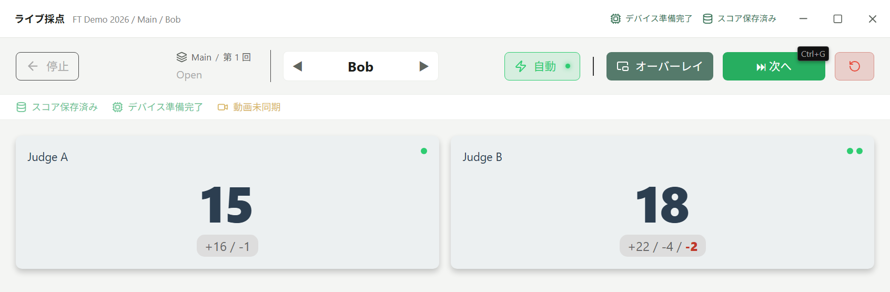

「自動」が有効な場合、「次へ」とリセット用ショートカットで直接進みます。無効な場合、「次へ」は確認を表示することがあり、ショートカットはゼロを実行します。「次回から確認しない」はそれぞれの確認設定を保存します。

**ゼロのみ：** 円形矢印の「ゼロ」を押し、表示された確認を確定します。現在の選手を維持してライブカウントをリセットします。過去イベントの削除やセッション無効化ではありません。過去イベントは残り、その後は新しいカウントで記録します。

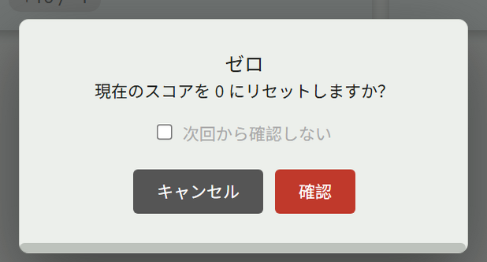

フリーモードは末尾に選手を追加します。大会の全選手が完了したら「保存して終了」または「続行（最初から）」を選べます。再採点は新しい記録であり、設定済みの次の試行ではありません。正式な第 2 試行などは設定に戻って選択してください。切り替え失敗時は入力を続ける前に現在の選手を確認します。

## 7. ウィンドウのオーバーレイと OBS

1. 対象アプリのウィンドウを先に開きます。
2. 採点ページの「オーバーレイ」からウィンドウ方式を選びます。
3. 対象ウィンドウまたはフルスクリーンを指定し、オーバーレイを開始します。

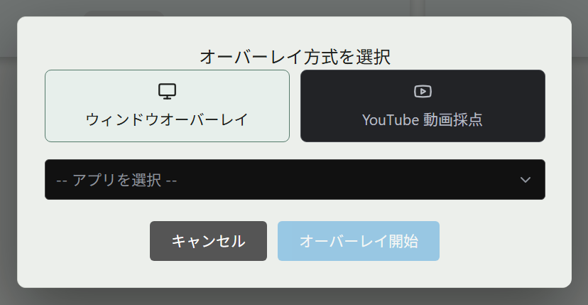

ドック領域にポインターを置くと、次の選手・リセット・波形表示・設定・終了の操作が現れます。ドックの `R` は即時にリセットするため、先に選手を確認してください。

カードのドラッグで移動し、角のハンドルでサイズを調整します。スコア文字をクリックしてホイールを回すと文字サイズが変わります。設定では内訳・合計・組み合わせ・リアルタイム、透明度、背景色を変更できます。リアルタイム表示は短時間の増分であり、最終合計ではありません。

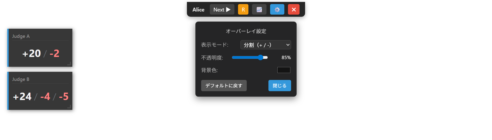

オーバーレイを閉じるとメイン画面に戻り、採点は継続します。アプリ全体を閉じる前に採点画面で保存して終了してください。OBS の結果は OS とキャプチャ方式に依存するため、本番前にメイン画面保護とスコア表示を確認します。

## 8. YouTube 動画採点

1. 現在の選手を確認して「オーバーレイ」を開きます。
2. YouTube 動画採点を選び、その選手の有効な YouTube URL を入力します。
3. プレイヤーを開いて読み込みを待ちます。スコア表示方式とパネル位置を調整できます。
4. カウンター入力前に動画と選手の一致を確認し、動画が同期済みになっていることを確かめます。
5. プレイヤーを終了すると審判カードに戻ります。リンク操作で動画を変更できます。選手切り替え後は紐付けを再確認します。

動画は選手ごとに保存され、採点入力はカウンターから行います。URL を貼り付けただけでは有効な動画時刻は得られません。未準備、同期期限切れ、動画や選手の不一致時も採点イベントは保存され得ますが、正確な動画ジャンプには使えません。後から動画を紐付けても、過去イベントの時刻は補完されません。

## 9. 保存して終了・セッション無効化

採点画面左上の「停止」を押し、処理を選びます。

- **保存して終了：** 現在のセッションを完了し、デバイスを停止してダッシュボードへ戻ります。失敗時は原因を解消して再試行し、採点中ではなくなったことを確認します。
- **セッションを無効化：** 2 回目の確認で選手・ステージ・グループ・試行を確認します。無効化状態となりますが、保存済みの生イベントは保持されます。
- **キャンセル：** 現在の採点に戻ります。

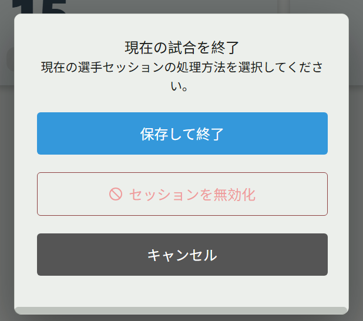

無効化とプロジェクト削除は別です。2.0.1 の完了選手検索はセッション状態で判定しますが、レポートと一部の出力は最新または全イベントを取得し、無効化イベントの除外が統一されていません。無効化後のレポートを、そのまま無効スコア除外済みの公式結果として扱わず、内容を照合してください。再採点した場合も確認が必要です。

## 10. 生スコアと換算レポート

大会一覧またはダッシュボードのグラフアイコンを開き、左側でグループを選びます。生スコアと換算スコアを切り替えられます。

生スコアには各審判の合計・正負カウント・重大減点が表示され、平均は設定された審判数で計算します。換算は各審判のグループ内最高の正の合計を基準にします。詳細設定で比率（初期値 60）と重大減点の適用を変更できます。

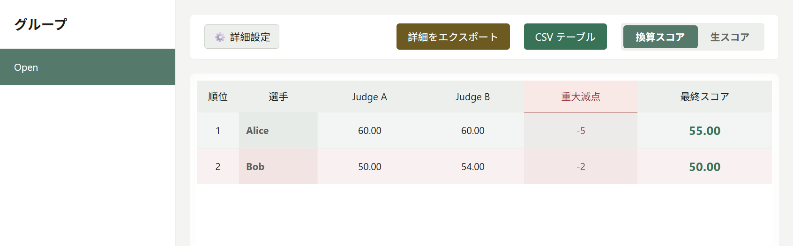

| 計算 | 規則 |
| --- | --- |
| 審判ごとの換算 | 生の合計 ÷ その審判のグループ内最高合計 × 比率。最高合計が正でなければ 0 |
| 標準重大減点 | 双機審判の重大減点の最頻値。頻度が同じなら大きい値 |
| 最終スコア | 設定済み全審判の換算平均 − 標準重大減点（有効時） |

欠損スコアは換算で 0 として扱います。生スコア平均も設定審判数を使い、欠損審判を自動除外しません。負の値になる場合もあります。

比率 60 の例では、Alice は 60 と 60 から 5 を引いて 55。Bob は 50 と 54 の平均 52 から 2 を引いて 50 です。現行レポートにはステージ・試行フィルターがなく、複数試行のベスト記録順位でもありません。ステージ間の同名グループ、繰り返しの試行、無効セッションを照合し、グループ名は区別しやすくしてください。

## 11. CSV・SRT・ZIP の出力

**CSV テーブル：** グループと生/換算表示を選び、比率・減点を確認して CSV テーブルを押し、システムの保存画面で場所を選びます。グループの集計を出力します。

**詳細 ZIP：** 詳細をエクスポートを開き、選手と形式を選んで ZIP をダウンロードし、保存先を指定します。選手 1 人以上と形式 1 種類以上が必要です。

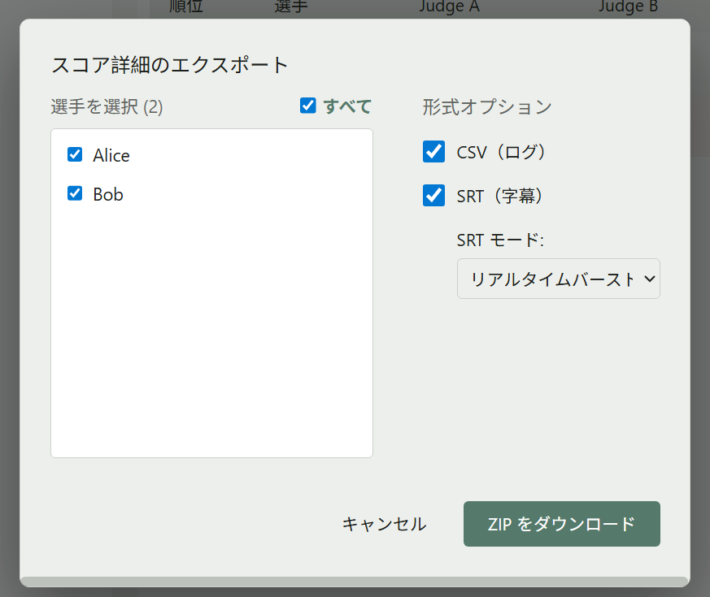

| 形式 | 内容 |
| --- | --- |
| CSV ログ | 相対時刻、正負カウント、合計、重大減点のイベント明細 |
| SRT | 合計、正/負、リアルタイム連打の字幕 |
| ZIP | グループ・選手・審判別に整理した明細 |

保存画面をキャンセルするとファイルは作成されません。これは失敗ではありません。イベントがなければ詳細は出力できません。失敗時は選択範囲・書き込み権限・空き容量を確認します。

SRT とログの時刻は各審判の最初の採点イベントのシステム時刻を基準とし、**YouTube の動画時刻ではありません**。編集時に手動で位置を合わせてください。[換算集計](../examples/Open_scaled.csv) と [詳細アーカイブ](../examples/FT_Demo_details.zip) で出力結果を確認できます。

## 12. イベント確認と動画リプレイ

1. 大会のリプレイアイコン、または左側のリプレイを開きます。
2. プレイヤー左端の細い領域にポインターまたはフォーカスを移すと、絞り込みとイベントのパネルが開きます。
3. プロジェクト・グループ・選手を選び、必要に応じて審判で絞り込みます。
4. イベントにはシステム時刻、主/副デバイス、増減、累計、動画同期状態が表示されます。
5. 同期済みで動画時刻のあるイベントをクリックすると、その位置へ移動します。未同期イベントは表示されますが、ジャンプできません。

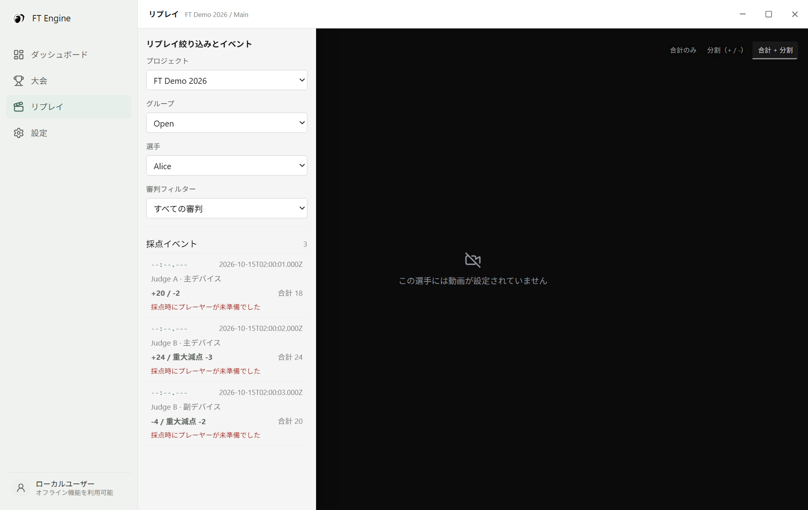

動画再生中のスコアパネルには利用可能な同期イベントが反映され、表示方式と位置を変更できます。動画なしでもイベントを確認できます。空の場合はプロジェクト・グループ・選手・審判を見直してください。パネルが閉じたら左端に再びポインターを置きます。

## 13. トラブル対応とデータ保持

| 症状 | 対応 |
| --- | --- |
| BLE が見つからない | Bluetooth、電源、距離、他の接続を確認して更新 |
| USB が反応しない | ケーブル、ポート、ドライバー、他アプリを確認 |
| 強制入場後にスコアが来ない | 待機省略だけなので実接続と割り当てを確認 |
| サービス異常 | サービスを再試行し、接続と入力を再確認 |
| 保存失敗 | 採点を止め容量・権限・ログを確認。データ削除で対処しない |
| 選手切り替え失敗 | エラーと現在の選手を確認してから続行 |
| 動画へ移動できない | 同期済み時刻が必要。後の紐付けでは補完されない |
| 出力失敗 | イベント、範囲、保存先の権限と容量を確認 |

現行の大会と設定は Electron のユーザーデータフォルダー内の SQLite（`ft-engine.db`）に保存されます。旧版の `match_data` と `app_settings.json` は現在の保存方式ではありません。続行可能なプロジェクトを残すには、アプリ終了後にユーザーデータフォルダー全体をバックアップします。CSV/ZIP は現行 UI から続行可能なプロジェクトとして復元できません。

プロジェクト削除は対象大会だけを削除します。全ローカルデータ削除はデータベースと WAL/SHM、バックアップ、管理対象の exports、logs を削除して再起動します。別の場所に保存した出力は別途管理します。どちらの削除も元に戻せません。

## 14. 一連の操作例

FT Demo 2026 を例に、接続、採点、選手切り替え、ゼロ、保存、結果確認の順で操作します。

| 選手 | Judge A 単機（正/負） | Judge B 主（正/負） | Judge B 副（正/負） | 合計 A/B | 減点 B | 比率 60 の最終値 |
| --- | --- | --- | --- | --- | --- | --- |
| Alice | 20 / 2 | 24 / 3 | 4 / 2 | 18 / 20 | 5 | 55.00 |
| Bob | 16 / 1 | 22 / 0 | 4 / 2 | 15 / 18 | 2 | 50.00 |

1. `FT Demo 2026 / Main / Open / 試行 1` に 3 台のカウンターを割り当て、開始後に採点画面を確認します。
2. Alice の値を入力し、合計 18・20 と重大減点 5 を照合します。
3. 「次へ」で Bob とゼロのスコアを確認してから Bob の値を入力します。
4. ゼロ確認を実行し、Bob のままで全スコアがゼロになったことを確認して再入力します。
5. 「停止 → 保存して終了」で採点状態が終了したことを確認します。
6. レポートの Alice 55.00・Bob 50.00、出力設定、Alice のリプレイイベント 3 件を確認します。
