# FT Engine 使用说明书

适用版本：2.0.1 · 更新日期：2026-10-15

[English](../en/manual.md) | [日本語](../ja/manual.md) | [文档与示例索引](../README.md)

## 1. 开始使用

FT Engine 是桌面电子裁判计分软件，可用 BLE 蓝牙或 USB 计数器进行自由练习和赛事计分，并提供悬浮比分、YouTube 视频计分、事件复盘和文件导出。

安装包用户安装并打开应用即可；Node.js、Python 是源码开发环境要求，不需要参赛工作人员另外安装。真实计分前，打开电脑蓝牙或连接 USB 计数器，确认设备有电且没有被其他软件占用。YouTube 播放需要网络；本地计分和报表可以离线使用。

左侧导航提供以下入口，旧版“首页历史记录弹窗”和“顶部设置面板”的操作已由这些页面替代。

| 页面 | 用途 |
| --- | --- |
| 工作台 | 新建比赛、最近赛事、继续现场工作、查看异常提示 |
| 赛事 | 查找项目、继续配置、查看报表、进入复盘、删除项目 |
| 复盘 | 按项目、组别、选手和裁判筛选计分事件 |
| 设置 | 语言、主题、快捷键、OBS 隔离、本地数据管理 |

赛事行中的播放、图表、场记板图标分别用于继续配置、报表和复盘；鼠标停留可查看按钮提示。“更多操作”中可删除项目，确认前先导出需要保留的资料。

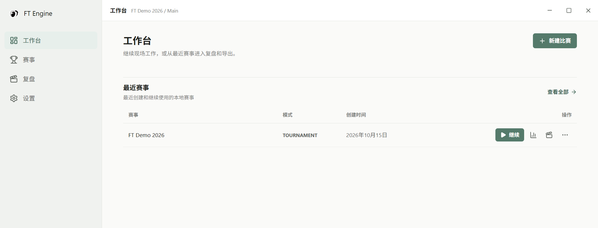

## 2. 语言、主题与现场设置

打开左侧“设置”。

1. 在“语言”中选择简体中文、English 或日本語，界面立即切换。
2. 选择浅色或深色主题。
3. 单击“重置快捷键”输入框，按下需要的组合键，例如 `Ctrl+G`；等待“已保存”。快捷键在计分页注册，若与系统快捷键冲突，请换一个组合。
4. 按需启用“OBS 隔离”。它用于保护主窗口内容，悬浮窗不受影响；直播前用实际 OBS 捕获方式预览确认效果。

计分页“自动”开启时，快捷键执行“下一位”；关闭时执行“归零”。“自动”默认开启，它不会按时间自动结束选手，也不会识别视频结束。设备连接状态与分数保存状态是两项独立检查。

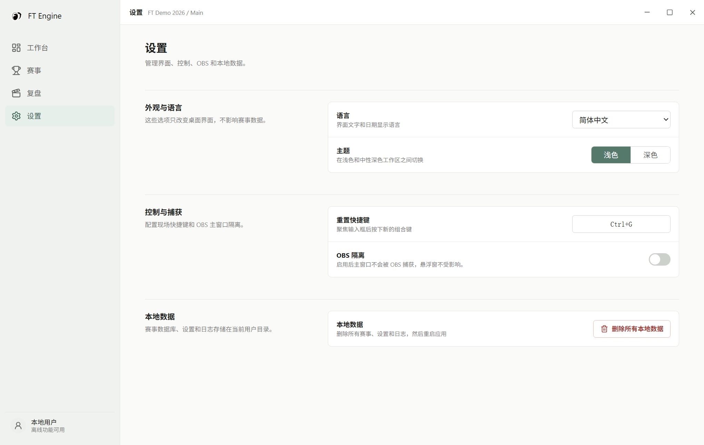

“删除所有本地数据”会删除本机的赛事数据库、备份、应用导出目录和日志，并重启应用。应用设置也保存在数据库中，因此会一并删除；这个操作无法撤销，详见第 13 节。

## 3. 创建项目、阶段和名单

从工作台或赛事页单击“新建比赛”，填写项目名称并选择模式。

**自由模式：** 设置裁判人数（1–32），单击“下一步”直接进入设备绑定。默认使用 `Main / Free Mode / Player 1`，当前为一次尝试；完成一位后可追加 `Player 2` 等选手。

**赛事模式：** 单击“下一步”进入“阶段与组别”。设置阶段名称、尝试次数（1–20），在各阶段配置组别、裁判数量和选手名单。名单每行一人；“导入名单”支持 CSV、XLSX、XLS，若检测到多列，需要选择姓名列并确认，导入后核对实际名单。

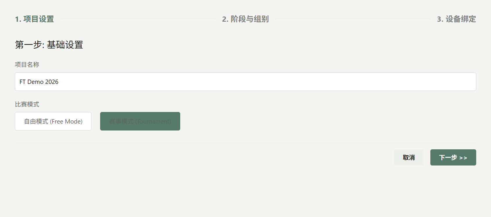

使用阶段列表下方的按钮新增、上移、下移或删除阶段；至少保留一个阶段。删除草稿阶段和调整结构需满足页面的可编辑条件。单击“保存并下一步”保存配置并进入设备绑定。

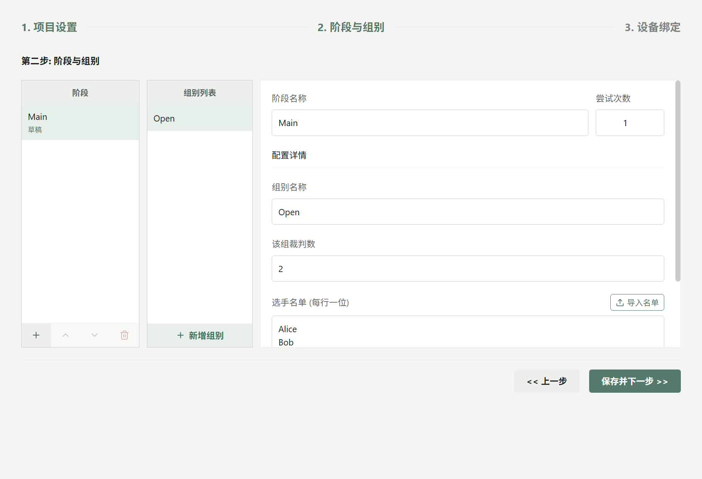

阶段状态为“草稿 / 进行中 / 已完成”。当前向导只有在全部阶段均为草稿时允许编辑结构；开始计分后先按既定阶段、组别和尝试继续使用。全部选手的全部尝试完成后，才可在阶段编辑页点击“完成阶段”；已完成阶段不会列入可启动阶段。下一次尝试需结束当前计分后，从“继续”重新选择，不会自动推进。

## 4. 扫描、绑定和连接计数器

1. 在设备绑定页确认要运行的阶段、组别、尝试次数。
2. 单击“刷新设备”。BLE 需开启蓝牙，USB 需系统识别相应端口；无设备时检查电源、连接和占用情况。
3. 为每位裁判输入名称，选择“单机”或“双机”，为所需主、副设备选择不同设备。一台设备不可重复分配。
4. 单击“开始比赛”，连接弹窗逐个显示主、副设备状态。
5. 全部所选设备连接成功后，软件会先归零再进入计分页。开始正式计分前核对选手、设备指示点和零分。

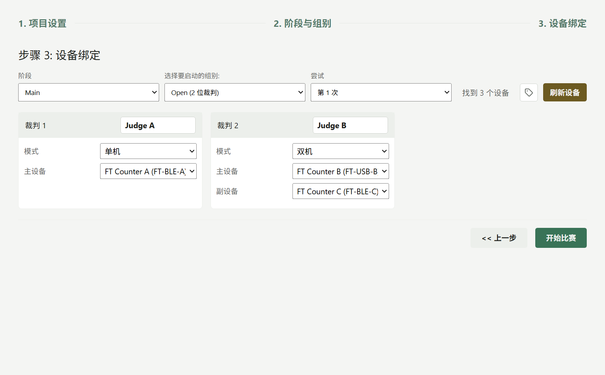

单机使用主设备；双机同时使用主、副设备。“重点扣分”是双机的计分含义提示，并非第三台设备。具体计算方式见第 5 节。

设备备注可本地保存。备注变化后出现的“永久修改设备名称”是另一个操作：只勾选确实需要写入蓝牙名称的设备，再执行“写入所选设备”；选择“暂不修改”仍保留本地备注。旧固件可能不支持永久改名。

连接约 8 秒未全部成功或有设备报错时，可取消检查，或选择“强制进入”。强制进入只跳过等待，不能让失败设备变成已连接。出现设备服务异常时，使用页面提供的“重试设备服务”，恢复后重新检查每个设备的状态与实际按键响应。

## 5. 连接成功后的现场计分

进入计分页后，先核对顶部的阶段、尝试、组别和当前选手；逐个按动设备验证裁判对应关系，再归零后开始正式记录。

| 状态 | 含义与操作 |
| --- | --- |
| 设备已就绪、裁判卡片状态点已连接 | 可以检查计数器输入是否对应正确裁判 |
| 正在重连设备 / 设备连接异常 | 暂停正式计分，检查设备并等连接恢复 |
| 正在保存分数 / 分数已保存 | 本地保存处理中 / 最近事件已写入 |
| 分数保存失败 | 暂停正式计分，检查磁盘空间、写入权限和日志 |
| 视频未对齐 / 视频已对齐 | 当前事件能否使用准确的视频时间；不等同于设备状态 |

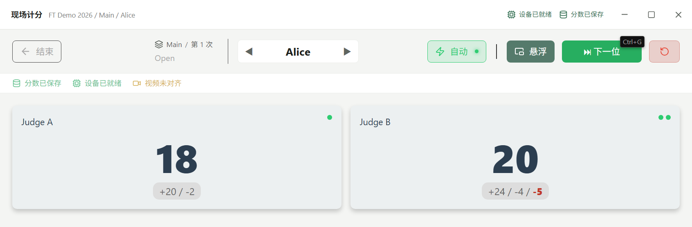

**单机：** 总分 = 主设备正计数 − 主设备负计数；正分、负分分别显示这两个计数，重点扣分为 0。

**双机：** 正分 = 主设备正计数，负分 = 副设备正计数，总分 = 正分 − 负分；重点扣分 = 主设备负计数 + 副设备负计数。重点扣分单独记录，不直接减去卡片上的总分；报表可在折算后再扣除。

演示中 Judge A 为单机，正 20、负 2，总分 18。Judge B 为双机：主设备正 24、负 3，副设备正 4、负 2，因此显示正 24、负 4、总分 20、重点扣分 5。

## 6. 下一位、手动切换与归零

**完成并切换：** 单击“下一位”完成当前选手并查找下一位未完成选手。切换成功后设备和界面归零，再开始下一位；选手下拉列表的勾号表示本次尝试已完成。箭头或下拉框也可以切换选手，切换同样涉及当前会话保存和设备归零，不能当作只读查看历史分数。

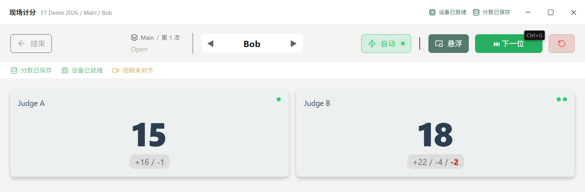

“自动”开启时，“下一位”和重置快捷键可直接推进；关闭后，“下一位”可显示确认框，快捷键执行归零。勾选“不再询问”会保存相应确认偏好。

**只归零：** 单击右侧圆形箭头“归零”，按提示确认。它保留当前选手并重置实时设备计数，不切换选手，不是删除历史记录。历史事件仍保留，后续分数以新设备计数继续记录。不要用归零代替作废会话。

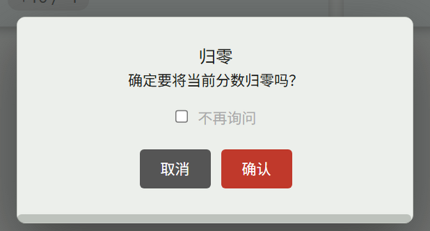

自由模式到达名单末尾会追加新选手；赛事模式全部完成后可“保存并退出”，或选择“继续（从头开始）”重新计分。重新计分会产生新的记录，不是另一次预设尝试；要进行第 2 次等正式尝试，应返回配置选择对应尝试。切换失败时确认当前选手仍是谁，处理错误后再继续，避免重复按键。

## 7. 窗口悬浮与 OBS

1. 提前打开要叠加的目标窗口。
2. 在计分页单击“悬浮”，选择“窗口悬浮”。
3. 选择一个窗口或“全屏模式”，单击“启动悬浮窗”。

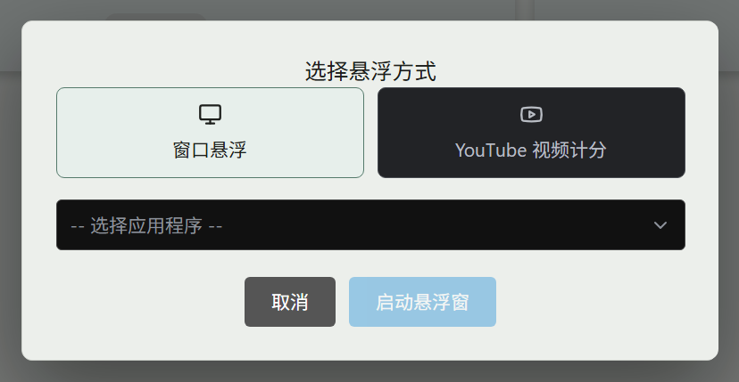

将鼠标移到悬浮窗控制条区域以显示操作按钮。可切换下一位、重置、显示或隐藏波形、打开设置或关闭悬浮窗。注意悬浮窗的 `R` 重置直接执行归零；正式使用前确认当前选手。

拖动卡片可移动位置，拖动角部手柄可调整大小。点击分数字形后滚动鼠标滚轮可调整字体大小。在设置中选择分项、仅总分、组合显示或实时连击，并调整透明度与背景色；“实时连击”是短时增量展示，不代表最终总分。

关闭悬浮窗会返回主窗口，计分会话继续；关闭整个应用前，应先在计分页保存并结束。OBS 捕获结果取决于操作系统和捕获源，赛前预览确认主窗口隔离及悬浮比分显示符合要求。

## 8. YouTube 视频计分

1. 在计分页确认当前选手，单击“悬浮”。
2. 选择“YouTube 视频计分”，粘贴该选手的有效 YouTube 链接。
3. 单击“进入播放器”，等待视频加载；可以切换比分显示方式、拖动比分面板位置。
4. 正式按动计数器前，确认视频与选手一致，并观察状态变为“视频已对齐”。
5. 用“退出播放器”返回裁判卡片；更换视频使用播放器工具栏的链接按钮。切换选手后再次核对视频绑定。

视频绑定按选手保存，设备仍负责计分。仅粘贴链接不等于已获得有效的视频时间。计分时播放器未就绪、同步已过期、视频或选手不匹配的事件仍可保存，但复盘不能把它们作为准确的视频跳转点。事后绑定视频也不会自动补齐过去事件的视频时间。

## 9. 保存结束与作废会话

单击计分页左上角“结束”，选择：

- **保存并结束：** 完成当前会话、停止设备并回到工作台。若结束未成功，处理提示后重试，确认已退出活动计分状态。
- **作废当前会话：** 再次核对选手、阶段、组别和尝试后确认。会话会标记作废，已保存的原始事件保留。
- **取消：** 返回当前计分。

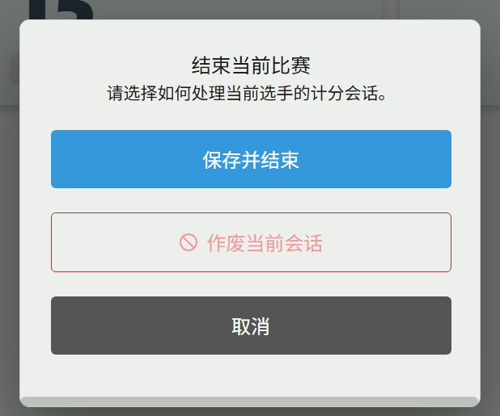

作废与删除项目是不同操作。2.0.1 的“已完成选手”查询按会话状态筛选，但报表与部分导出查询仍读取最新或全部事件，尚未统一排除作废事件。因此作废后不要直接把报表当作已剔除无效成绩的最终结果，需人工核对。重复计分也应核对最终报表所取的事件。

## 10. 报表、原始分与折算分

在工作台或赛事列表，点击项目的图表图标进入报表，选择左侧组别。可在“原始分”和“折算分”之间切换。

原始分展示每位裁判的总分、正负计数及重点扣分，平均分按配置的裁判人数计算。折算分按当前组内每位裁判的最高正总分归一化；“高级设置”可调整比例（默认 60）和“显示重点扣分”。

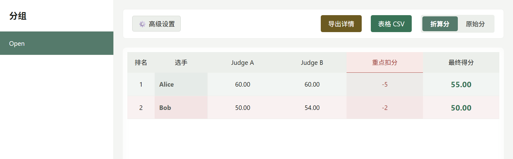

| 计算项 | 规则 |
| --- | --- |
| 单位裁判折算分 | 原始总分 ÷ 该裁判组内最高总分 × 比例；最高分不大于 0 时为 0 |
| 标准重点扣分 | 只收集双机裁判的重点扣分，取众数；出现频率并列时取较大值 |
| 最终分 | 所有配置裁判折算分的平均值，再减标准重点扣分（启用时） |

缺失成绩在折算计算中按 0 参与；原始平均也使用配置裁判数，不会自动跳过未计分裁判。分数可能为负。

演示比例 60：Alice 的两项折算分均为 60，减 5 得 55；Bob 为 50 和 54，平均 52，减 2 得 50。当前报表界面没有阶段或尝试筛选器，也不是“多次尝试取最佳”排名。多阶段同名组、重复尝试或作废会话需要额外核对，建议阶段间使用容易区分的组名。

## 11. 导出 CSV、SRT 和 ZIP

**表格 CSV：** 在报表选择组别及原始分/折算分，确认比例与重点扣分选项后单击“表格 CSV”，在系统保存框选择位置。它导出当前组的成绩汇总。

**明细 ZIP：** 单击“导出详情”，勾选选手和格式，至少选择一位选手及一种格式，再单击“下载 ZIP”并选择保存位置。

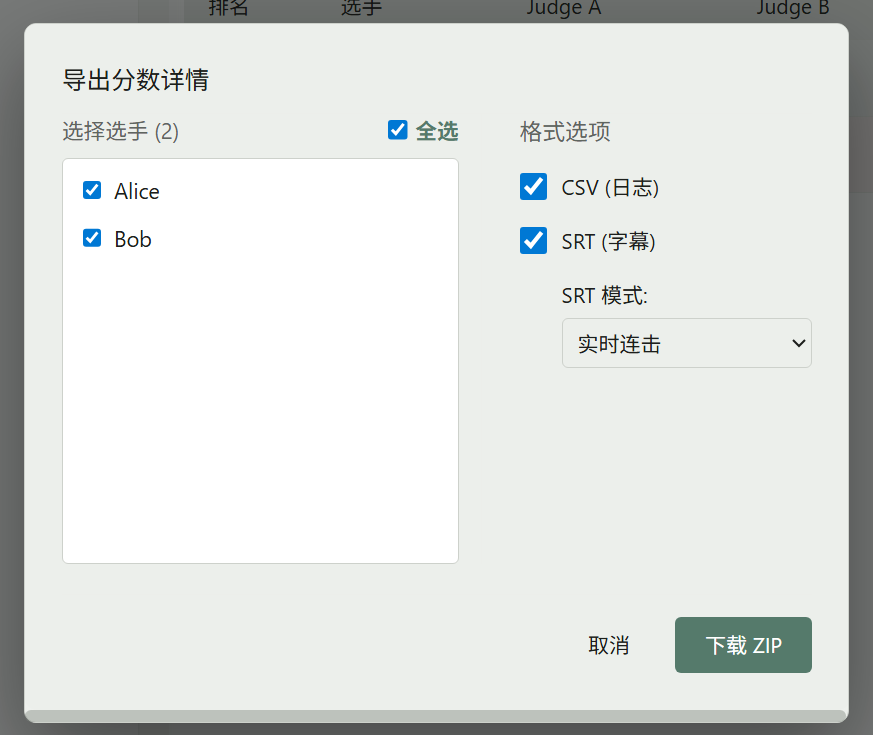

| 格式 | 内容 |
| --- | --- |
| CSV（日志） | 相对时间、正计数、负计数、总分和重点扣分的事件明细 |
| SRT（字幕） | 选择总分、正分/负分或实时连击模式的字幕 |
| ZIP | 按组别、选手、裁判组织上述明细文件 |

取消系统保存框不会导出文件，也不是失败。没有计分事件时无法导出详情；遇到失败检查目标目录权限、空间和是否选错项目/选手。

SRT 和日志相对时间以各裁判首个计分事件的系统时间为起点，**不是 YouTube 视频时间轴**；剪辑时需要自行对齐。示例文件见 [折算汇总](../examples/Open_scaled.csv) 与 [事件明细](../examples/FT_Demo_details.zip)。

## 12. 查看事件与视频复盘

1. 点击赛事行的复盘图标，或左侧“复盘”。
2. 将鼠标移到播放器左侧窄边或聚焦边栏，展开“复盘筛选与事件”。
3. 选择项目、组别、选手，可进一步筛选裁判。
4. 事件列表显示系统时间、设备主副角色、分数变化、累计值和视频同步状态。
5. 对“已对齐”且带视频时间的事件，可点击跳到对应视频位置；未对齐事件保留在列表中，但不能点击跳转。

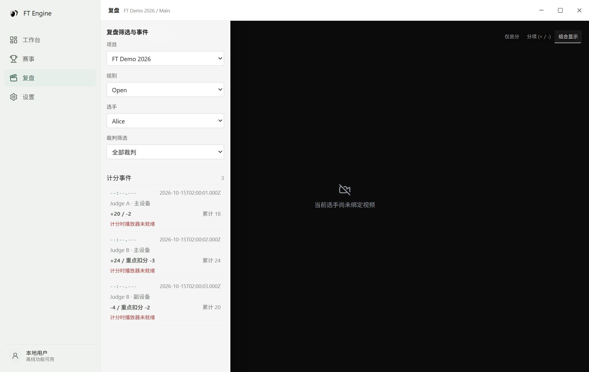

播放绑定视频时，比分面板按视频时间显示可用的同步事件，也可切换显示方式、拖动面板。没有视频时仍能检查事件；列表无事件则重新核对项目、组别、选手及裁判筛选。没有看到边栏时，重新移入左侧窄边即可展开。

## 13. 异常处理与数据保留

| 现象 | 处理 |
| --- | --- |
| 扫描不到 BLE 设备 | 开启蓝牙、检查电量与距离，释放其他连接后刷新 |
| USB 无响应 | 检查线材、端口、驱动及其他程序占用 |
| 强制进入后无分数 | 它只跳过等待；检查设备真实连接及主、副设备绑定 |
| 设备服务异常 | 使用“重试设备服务”，恢复后验证连接和输入 |
| 分数保存失败 | 暂停计分，检查空间、权限和日志；不要通过删除数据排错 |
| 选手切换失败 | 确认错误提示和当前选手，修复后再试，避免继续记到上一位 |
| 视频不能跳转 | 确认事件有已对齐的视频时间，事后绑定不会回填 |
| 导出失败 | 确认有事件、选对范围，改用可写目录并检查空间 |

赛事和设置保存在 Electron 用户数据目录中的 SQLite（`ft-engine.db`），不再使用旧版 `match_data` 与 `app_settings.json` 作为当前存储。要保留可继续比赛的数据，退出应用后备份整个用户数据目录；CSV/ZIP 是结果文件，不能通过当前界面恢复为可继续计分的项目。

赛事行的“删除项目”删除该项目。设置中的“删除所有本地数据”删除数据库及其 WAL/SHM 文件、`backups`、应用管理的 `exports` 和 `logs`，然后重启；自己另存到其他目录的导出文件需自行管理。两种删除均不可撤销。

## 14. 完整操作示例

以下以 `FT Demo 2026` 为例，按照连接、计分、切换选手、归零、保存与查看结果的顺序完成一次操作。

| 选手 | Judge A 单机（正 / 负） | Judge B 主（正 / 负） | Judge B 副（正 / 负） | 原始总分 A / B | 重点扣分 B | 最终分（比例 60） |
| --- | --- | --- | --- | --- | --- | --- |
| Alice | 20 / 2 | 24 / 3 | 4 / 2 | 18 / 20 | 5 | 55.00 |
| Bob | 16 / 1 | 22 / 0 | 4 / 2 | 15 / 18 | 2 | 50.00 |

1. 以 `FT Demo 2026 / Main / Open / 第 1 次` 绑定三台计数器，开始并确认进入计分页。
2. 输入 Alice 的计数，核对 18、20 和重点扣分 5。
3. 单击“下一位”，确认切为 Bob 且分数归零；输入 Bob 的计数。
4. 打开归零确认并执行，确认仍为 Bob 且分数为零；重新输入 Bob 数据。
5. 选择“结束 → 保存并结束”，确认不再处于活动计分状态。
6. 在报表核对 Alice 55.00、Bob 50.00，打开导出选项；在复盘核对 Alice 的 3 条原始事件。
